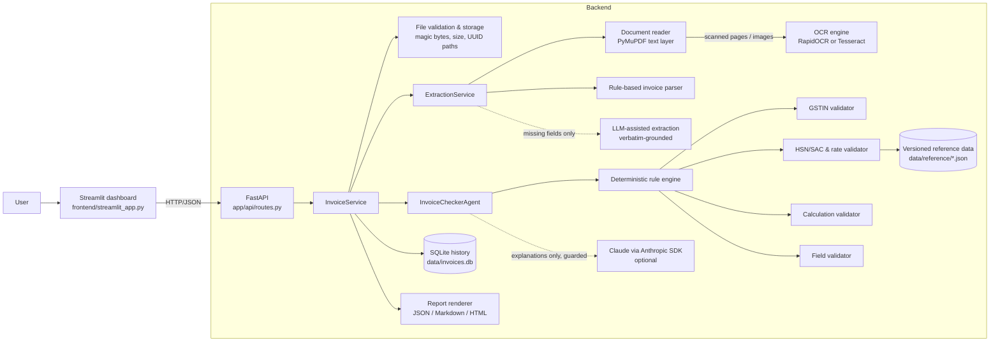
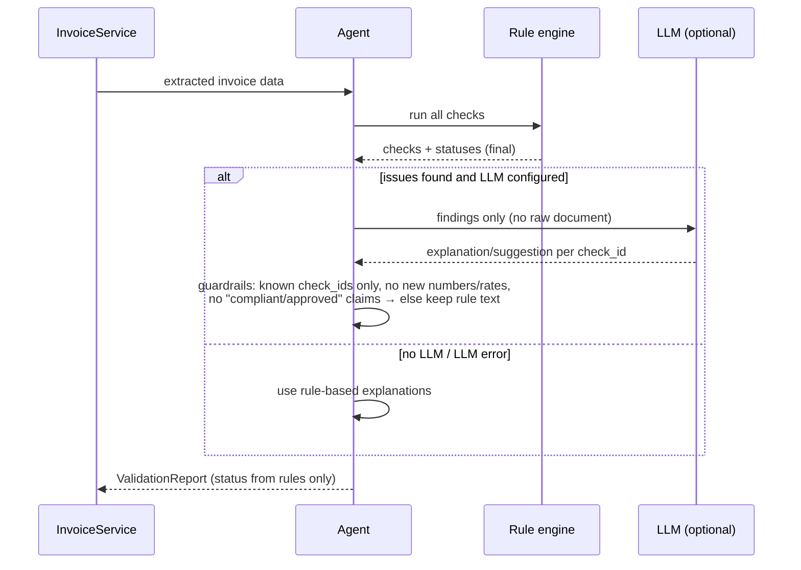

# GST Invoice Checker Agent

An AI-assisted validation tool for Indian GST invoices. Upload a PDF or image invoice; the system extracts its fields with OCR, runs deterministic GST checks (GSTIN, HSN/SAC rates, tax arithmetic, place of supply), and produces a structured report with plain-language explanations and suggested corrections.

> **Disclaimer.** This is an assistance tool, not a substitute for review by a qualified GST practitioner or chartered accountant. A `VALID` result means *all automated checks passed*. It does **not** certify that an invoice is GST-compliant or approved for filing. GST rates come from a local sample dataset that is **not legally authoritative**.

---

## Problem statement

Small businesses in India receive many purchase invoices and need them to be correct before claiming input tax credit (ITC). Common problems include:

- GSTINs with typos or OCR errors, which make the ITC claim fail.
- The wrong GST rate for an HSN/SAC code.
- IGST charged on an intra-state supply, or CGST/SGST on an inter-state one.
- Arithmetic errors in line totals, tax amounts or the invoice total.
- Mandatory fields that are missing, such as the invoice number, HSN code or place of supply.

Checking all of this by hand is slow and easy to get wrong. This project automates the mechanical checks and explains the results in simple language. It also says clearly which items still need a human to verify them.

## Features

| Area | What it does |
|---|---|
| **Upload** | PDF, PNG and JPG files up to 10 MB. Files are checked by their magic bytes (not the extension), corrupted or password-protected files are rejected, and every file is stored under a server-generated UUID name. |
| **Extraction** | Uses the PDF text layer when it exists and falls back to OCR for scans and images. The rule-based parser handles Indian number formats (`1,77,000.00`) and day-first dates. Fields it cannot find stay **missing** and are never guessed. Low-confidence OCR fields are marked **uncertain**. |
| **AI-assisted extraction (optional)** | An LLM may fill fields the parser missed. Each value must appear **verbatim in the document text** or it is discarded, so the LLM cannot introduce data. Accepted values are marked uncertain and sent to manual review. |
| **GSTIN validation** | Checks presence, length/format (state code + PAN + entity code + `Z` + checksum), the state/UT code, and the base-36 checksum. **Format errors and checksum errors are reported as separate checks.** |
| **HSN/SAC & rates** | Looks up codes against a versioned reference file using longest-prefix matching. It flags missing, malformed and unknown codes, compares rates with high-confidence entries, sends low-confidence entries to **manual review**, and treats invoices dated before the dataset's effective date as unverifiable. |
| **Tax calculations** | Checks quantity × price, the sum of line values, the supply type (intra-state vs inter-state, from the supplier's GSTIN state and the place of supply), the tax head charged, CGST = SGST, the expected CGST/SGST/IGST, total tax, round-off, and the invoice total, all within a configurable rounding tolerance. |
| **Agent** | A 6-step workflow: receive → run deterministic rules → collect findings → explain (LLM or templates) → suggest corrections → build the report. The LLM **cannot change any status**. |
| **Report** | Overall `VALID` / `INVALID` / `NEEDS REVIEW` status, counts, extracted data, every check, explanations, corrections, manual-verification items, assumptions and the agent trace. Exports to JSON, Markdown and HTML. |
| **Dashboard** | Streamlit UI with upload, invoice preview, extracted fields, a form to correct values and re-validate, the issues list, a table of all checks, report downloads and processing history (SQLite). |

### Status semantics

| Check status | Meaning |
|---|---|
| `PASS` | Valid information |
| `FAIL` | Invalid information (error) |
| `MISSING` | Information not found on the invoice |
| `WARNING` | Suspicious or inconsistent information |
| `MANUAL_REVIEW` | Cannot be verified automatically (for example, a low-confidence rate or an unknown supply type) |

Overall status: any **error** gives `INVALID`. Otherwise, any warning, missing item or manual-review item gives `NEEDS REVIEW`. If every check passed, the status is `VALID`.

## Architecture



### Agent workflow and guardrails



## Technology stack and library choices

| Component | Choice | Why |
|---|---|---|
| API | **FastAPI** + Uvicorn | Typed request and response models, automatic OpenAPI docs at `/docs`, and simple dependency injection. |
| Schemas | **Pydantic v2**, pydantic-settings | Structured invoice and report models. Settings come from environment variables or `.env`. |
| PDF | **PyMuPDF** (`pymupdf`) | Fast and has no external binaries. It gives word-level coordinates (used to rebuild table columns), renders scanned pages for OCR, and detects corrupted or encrypted PDFs. |
| Images | **Pillow** | Decodes and verifies uploads, with a decompression-bomb guard. |
| OCR | **RapidOCR** (`rapidocr_onnxruntime`), with **Tesseract** as a fallback | RapidOCR installs with `pip` (ONNX models included) and needs no system install, which matters on Windows. It was accurate on the sample scans (line confidence 0.95–1.0). Tesseract is used automatically if RapidOCR is unavailable and the binary is installed. |
| LLM | **Claude** (`claude-opus-5-5`) through the official **Anthropic Python SDK** | Uses structured JSON output (`output_config.format`), low effort for short explanations, and server-side refusal fallback. It is fully optional. |
| Storage | **SQLite** (standard library) | No extra service is needed for processing history. |
| Frontend | **Streamlit** | A clean data UI built quickly in Python. It talks to the backend only over HTTP. |
| Tests | **pytest**, FastAPI `TestClient` | 110 tests covering units, integration and the API. |

## Folder structure

```
gst-invoice-checker-agent/
├── app/
│   ├── main.py                 # FastAPI app factory + error handlers
│   ├── api/                    # routes.py (endpoints), dependencies.py (service wiring)
│   ├── core/                   # config.py (settings), logging.py (PII redaction), exceptions.py
│   ├── models/                 # invoice.py, validation.py (report), api.py (HTTP schemas)
│   ├── services/               # file_service, document_reader, ocr_service, invoice_parser,
│   │                           # extraction_service, reference_data, storage, report_service,
│   │                           # invoice_service (orchestration)
│   ├── validators/             # gstin, gstin_rules, hsn, calculation, fields, engine, base
│   ├── agent/                  # invoice_agent (workflow + guardrails), llm_client,
│   │                           # llm_extraction (grounded), prompts
│   └── utils/                  # money (Decimal/₹ helpers), sample_invoice (synthetic renderer)
├── frontend/
│   ├── streamlit_app.py        # dashboard
│   └── api_client.py           # HTTP client for the backend
├── data/
│   ├── reference/              # hsn_sac_rates.json, state_codes.json (versioned)
│   ├── sample_invoices/        # synthetic PDFs/PNG for demos
│   └── uploads/                # stored uploads (git-ignored)
├── scripts/
│   ├── generate_sample_invoices.py
│   └── demo_workflow.py        # end-to-end demo against the running API
├── tests/                      # pytest suite
├── reports/                    # generated JSON/Markdown reports (git-ignored)
├── docs/design-notes.md
├── .streamlit/config.toml
├── .env.example
├── requirements.txt
└── README.md
```

## Installation

Requirements: Python 3.11+ (developed and tested on 3.12, Windows 11).

```bash
python -m venv .venv
```

```bash
# Windows (Git Bash / PowerShell)
.venv/Scripts/activate
# macOS / Linux
source .venv/bin/activate
```

```bash
pip install -r requirements.txt
```

The first OCR call loads the RapidOCR models, which takes a few seconds. Later calls are faster.

## Environment configuration

Copy `.env.example` to `.env` and adjust as needed. Every setting has a working default, so `.env` is optional.

| Variable | Default | Purpose |
|---|---|---|
| `ANTHROPIC_API_KEY` | *(empty)* | Turns on LLM explanations and AI-assisted extraction. If it is empty, the app runs on rules only. |
| `LLM_PROVIDER` | `anthropic` | Set to `none` to turn off the LLM even when a key is present. |
| `LLM_MODEL` | `claude-opus-5-5` | Claude model ID. |
| `LLM_ASSISTED_EXTRACTION` | `true` | Lets the LLM fill fields the parser missed (grounded values only). |
| `OCR_ENGINE` | `auto` | `auto`, `rapidocr` or `tesseract`. |
| `TESSERACT_CMD` | — | Path to `tesseract.exe` if it is not on `PATH`. |
| `MAX_UPLOAD_MB` | `10` | Upload size limit. |
| `MAX_PDF_PAGES` | `10` | Maximum number of PDF pages processed. |
| `ROUNDING_TOLERANCE` | `1.0` | Differences up to this amount in rupees are treated as rounding. |
| `API_BASE_URL` | `http://127.0.0.1:8000` | Backend URL used by the Streamlit app. |

Secrets are read only from the environment. Never commit `.env`; it is already in `.gitignore`.

## Running the application

**1. Start the FastAPI backend**

```bash
uvicorn app.main:app --host 127.0.0.1 --port 8000
```

Interactive API docs: http://127.0.0.1:8000/docs

**2. Start the Streamlit frontend** (in a second terminal)

```bash
streamlit run frontend/streamlit_app.py
```

Open http://localhost:8501, upload one of the files from `data/sample_invoices/`, and click **Validate invoice**.

**3. (Optional) Run the command-line demo** against the running backend

```bash
python scripts/demo_workflow.py data/sample_invoices/invalid_gst_errors.pdf
```

## API endpoints

| Method | Path | Description |
|---|---|---|
| `GET` | `/health` | Service status, OCR engine, whether the LLM is configured, and the reference-data version. |
| `POST` | `/invoices/upload` | Multipart `file`. Validates and stores the file, runs extraction, and returns `invoice_id` and the extraction result. **201** |
| `POST` | `/invoices/{invoice_id}/validate` | Runs the agent. The optional JSON body `{"invoice": {...corrected data...}, "use_llm": true}` re-validates with user corrections. |
| `GET` | `/invoices/{invoice_id}` | Invoice record with its extraction and latest status. |
| `GET` | `/invoices/{invoice_id}/report?format=json\|markdown\|html` | The validation report. Returns **404** until the invoice has been validated. |
| `GET` | `/invoices/{invoice_id}/file` | The originally uploaded file (used for preview). |
| `GET` | `/invoices?limit=50` | Processing history. |

Errors use a consistent shape that never echoes invoice data:

```json
{"error": "unsupported_file_type", "detail": "Unsupported file type '.exe'. Upload a PDF, PNG or JPG invoice."}
```

| Code | When |
|---|---|
| 400 | Empty, corrupted, mislabelled or password-protected file |
| 404 | Unknown invoice, or report not generated yet |
| 413 | File too large |
| 415 | Unsupported extension |
| 422 | Malformed request |

Example:

```bash
curl -F "file=@data/sample_invoices/valid_intra_state.pdf" http://127.0.0.1:8000/invoices/upload
```

```bash
curl -X POST http://127.0.0.1:8000/invoices/<invoice_id>/validate
```

```bash
curl "http://127.0.0.1:8000/invoices/<invoice_id>/report?format=markdown"
```

## Testing

```bash
python -m pytest
```

The suite has 110 tests and runs in about 11 seconds, including real OCR on rendered invoice images. It covers:

| Area | File |
|---|---|
| Valid / invalid / missing GSTIN; format vs checksum vs state-code errors | `tests/test_gstin.py` |
| Incorrect, unknown, malformed and missing HSN/SAC; rate mismatch; low-confidence entries; effective date | `tests/test_hsn.py` |
| CGST/SGST and IGST calculations, wrong tax head, incorrect totals, rounding, round-off, line arithmetic | `tests/test_calculation.py` |
| Missing invoice fields, future dates, uncertain fields, failed extraction | `tests/test_fields.py` |
| PDF text and OCR extraction, scanned PDFs, OCR unavailable or crashing, blank images, grounded LLM extraction | `tests/test_extraction.py` |
| Invalid / corrupted / oversized / mislabelled uploads, path traversal in file names | `tests/test_file_validation.py` |
| LLM unavailable fallback, LLM failure, guardrails (no status override, no invented rates, no compliance claims) | `tests/test_agent.py` |
| End-to-end API workflow, corrections, error codes | `tests/test_api.py` |

All test data is synthetic. The GSTINs are generated from made-up PANs with a valid checksum, and none of it is used as GST reference data.

## Sample invoice workflow

Regenerate the samples at any time with `python scripts/generate_sample_invoices.py`.

| File | Scenario | Result |
|---|---|---|
| `valid_intra_state.pdf` | Karnataka → Karnataka, CGST + SGST at 18% | `VALID` (28/28 checks) |
| `valid_inter_state.pdf` | Maharashtra → Gujarat, IGST at 18%, round-off ₹0.10 | `VALID` (26/26) |
| `invalid_gst_errors.pdf` | Bad GSTIN checksum, 12% on a laptop, line arithmetic error, CGST ≠ SGST, wrong total | `INVALID` (7 errors) |
| `missing_fields.pdf` | No invoice number, no place of supply, no recipient GSTIN, one line without an HSN code | `INVALID` (missing invoice number) |
| `scanned_intra_state.png` / `.pdf` | Image-only versions of the valid invoice, read through OCR | `VALID` |

Output of `python scripts/demo_workflow.py data/sample_invoices/invalid_gst_errors.pdf` (abridged):

```
STEP 1 - Upload: invalid_gst_errors.pdf
STEP 2 - Extraction: status=success method=pdf_text
STEP 3 - Validate GSTIN, HSN/SAC rates and tax calculations
  [FAIL]    Supplier GSTIN checksum: Checksum error: ... last character is '0' but the first 14 characters produce 'Q'
  [FAIL]    Line 1 GST rate: Applied rate 12% ... does not match the reference rate 18% for 8471
  [FAIL]    Line 1 quantity × price: 2 × ₹45,000.00 = ₹90,000.00, but the invoice shows ₹95,000.00
  [FAIL]    CGST equals SGST: CGST ₹6,780.00 ≠ SGST ₹6,700.00
  [FAIL]    Invoice total: Total should be ₹1,20,480.00 ... but the invoice shows ₹1,25,000.00
STEP 5 - Final validation report
  OVERALL STATUS: INVALID
  checks=28 passed=21 errors=7 warnings=0 manual_review=0
```

## Reference data

`data/reference/hsn_sac_rates.json` is a **sample** dataset. It has a version (`2025.09-sample-v1`), an effective date (`2025-09-22`, the date of the GST rate rationalisation), a source note and an explicit "not legally authoritative" status. Each entry has a `confidence` level:

- `high`: a long-standing standard rate. A mismatch is reported as an error.
- `low`: a conditional or recently changed rate. Any comparison against it goes to manual review.

Codes not in the file produce a warning; the tool never guesses a rate for them. To extend the dataset, verify each rate against the current CBIC notifications, add the entry, and bump `version`.

## Security and reliability

- API keys are read only from environment variables. The LLM client is never built without a key.
- Uploads are validated by magic bytes, size, page count, full decode and encryption checks. The client's filename is sanitized for display only. Files are stored under server-generated UUIDs, path resolution is checked against the upload directory, and uploaded content is never executed.
- Logs never contain invoice content. A logging filter also redacts GSTIN, PAN and API-key patterns in case one is logged by mistake.
- Request validation errors list the invalid field names but never echo submitted values.
- OCR and LLM failures are caught and turned into an `extraction_failed` result or a rule-based fallback; they never crash a request.
- The document text sent to the LLM is treated as untrusted data, and the prompts tell the model to ignore any instructions inside it.

## Limitations

- **The rule-based parser is tuned to common labelled layouts** (for example `Invoice No:`, `GSTIN:`, `Place of Supply:`, or a table with an HSN column). Unusual layouts, rotated scans, handwritten invoices and multi-row line items may lose fields. Lost fields show up as *missing*, never as invented values, and can be corrected in the UI.
- **OCR may merge words.** RapidOCR sometimes drops spaces; camel-case word boundaries are restored, but lower-case runs such as `softwaredevelopment` stay merged.
- **Reference rates are a small sample** and are not legally authoritative. The status of a GSTIN on the GST portal (active, cancelled or suspended), e-invoice/IRN applicability and reverse charge are not checked automatically; they are always listed under manual verification.
- **Supply-type rules are simplified.** The tool compares the supplier's state with the place of supply. SEZ supplies, exports, deemed exports and special place-of-supply rules for services are not modelled.
- **Discounts, cess, TCS and multi-rate split lines** are not modelled.
- **The LLM path is tested with fake clients only.** No API key was available during development, so the real Claude API call has not been exercised end to end. Without a key the app is fully functional in rule-based mode.

## Features that need external API keys

| Feature | Requires | Without it |
|---|---|---|
| Plain-language LLM explanations and an AI summary | `ANTHROPIC_API_KEY` | Rule-based explanations and suggestions (always available) |
| AI-assisted extraction of fields the parser missed | `ANTHROPIC_API_KEY` | Those fields are reported as missing |

Everything else, including OCR, all validations, reports and the dashboard, runs locally with no API keys.

## Future improvements

- Look up live GSTIN status through a GST Suvidha Provider (GSP) API.
- Verify e-invoice IRN and QR codes.
- Add a layout-aware extraction model for arbitrary invoice formats, and support multi-page line items.
- Build a full HSN/SAC rate table with effective-date history, loaded from official CBIC notifications.
- Process invoices in batches and reconcile them against GSTR-2B.
- Add authentication and multi-user history for hosted deployments.
